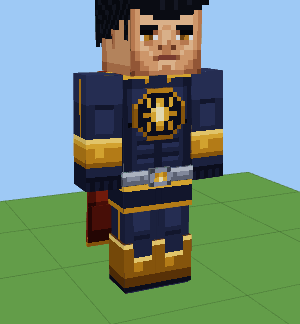
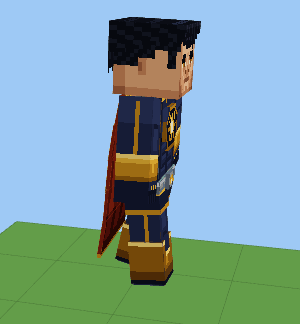
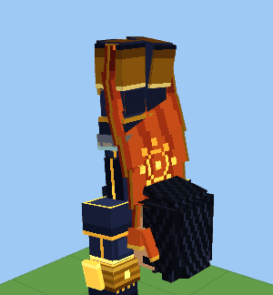
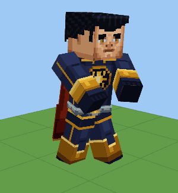
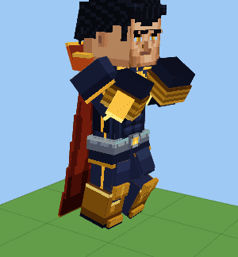
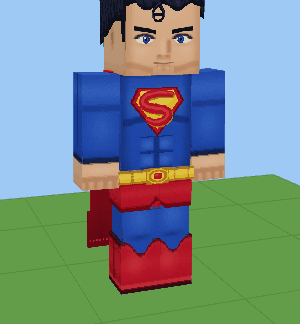
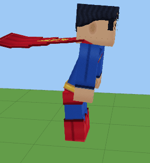
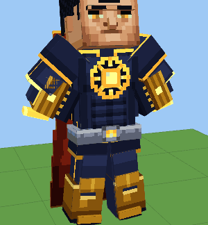
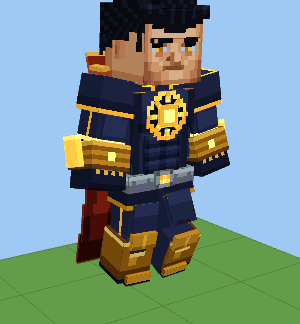

# Solaris – Herói Voador (Add-on para Minecraft Bedrock)

Add-on que transforma o jogador em **Solaris**, um super-herói original. Ele voa com física suave, tem visão de calor, sopro congelante, super força, super velocidade e um combo de luta completo, e **destrói o cenário** com o voo e os poderes. O foco principal são as **animações**: são 91, com transições suaves entre todos os estados. O personagem tem um **modelo 3D esculpido e articulado** (cotovelos, joelhos, capa em 6 partes), skin em **pixel art detalhada** e uma **camada que brilha no escuro**.

> **Versão 2.0.2:** o sopro congelante usado voando não esconde mais o herói, e a deformação nos impactos não encolhe mais partes do corpo.
>
> **Versão 2.0.1:** correções do sopro congelante (não cria mais gelo dentro do herói), das texturas que piscavam e da capa atravessando o chão.
>
> **Versão 2.0.0, a grande melhoria.** Modelo 3D novo com 72 peças e 29 ossos: peito, ombros e bíceps em relevo, cotovelos e joelhos articulados, botas e braceletes esculpidos e capa em 6 segmentos. Todas as animações foram refeitas usando as articulações, e o herói ficou maior e mais imponente. O emblema, os olhos, os frisos e os braceletes **brilham** e acendem mais forte com os poderes. Os efeitos ganharam clarões, anéis de choque em sequência, paredes de poeira, detritos flutuando, coluna de luz, gotas derretidas e **pilares de gelo**. E há um poder supremo novo: a **Explosão Solar**. Veja o [histórico de mudanças](CHANGELOG.md).


---

## Instalação

1. Baixe **[`dist/Solaris_Addon.mcaddon`](dist/Solaris_Addon.mcaddon)**.
2. Abra o arquivo:
   - **Windows:** dê dois cliques. O Minecraft abre e importa os dois pacotes.
   - **Android/iOS:** toque no arquivo e escolha abrir com o Minecraft. No iOS, salve em *Arquivos* e toque nele.
3. Crie ou edite um mundo e ative, em **Pacotes de comportamento**, o *Solaris - Herói Voador (Comportamento)*. O pacote de recursos é ativado junto.
4. **Não precisa ativar nenhuma opção experimental.**

> Requer **Minecraft Bedrock 1.26.30 ou mais recente**. Os pacotes também estão separados em `dist/Solaris_BP.mcpack` e `dist/Solaris_RP.mcpack`.
>
> Se você já tinha a versão anterior, os itens do seu mundo continuam funcionando, porque os IDs internos não mudaram.
>
> O add-on modifica a entidade do jogador. Outros add-ons que também alteram o jogador (`player.json` / `player.entity.json`) podem entrar em conflito.

---

## Como jogar

Ao entrar no mundo pela primeira vez você recebe o **Emblema Solar**. Se perder, dá para fabricar:

```
 Redstone | Ouro     | Redstone
 Ouro     | Diamante | Ouro
          | Redstone |
```

**Use o Emblema** para se transformar. Ao se transformar você recebe os 5 itens de poder, e na primeira vez aparece um **guia rápido** no chat. Os itens:

- têm **descrição de uso**: passe o dedo ou o mouse sobre eles;
- **não caem ao morrer**;
- **não aparecem na mão do personagem**: em terceira pessoa ele fica de mãos livres e em primeira pessoa aparece o punho.

### Controles

| Ação | PC | Celular |
|---|---|---|
| **Começar a voar** | pular e pular de novo no ar | pulo duplo |
| **Decolagem carregada** (com cratera) | segurar **agachar** parado, depois **pular** | segurar agachar, tocar pular |
| Subir / descer no voo | segurar pular / agachar | segurar pular / agachar |
| Voar para frente | W (o corpo segue a câmera) | analógico para frente |
| **Voo supersônico** (atravessa montanhas) | correr (Ctrl ou W duplo) voando | botão de correr / analógico todo à frente |
| Frear e pairar | soltar W | soltar o analógico |
| Pousar | descer até o chão, ou usar **Poder: Voo** | idem |
| **Super velocidade** no chão | correr transformado | correr |
| **Combate** | atacar (no chão: 6 golpes; no ar: 3) | atacar |
| Socar bloco (quebra na hora) | atacar o bloco de mão vazia | idem |
| **Configurações** | agachar + usar o Emblema | idem |

### Combate corpo a corpo

Ao acertar um inimigo, o herói entra em **postura de luta**: guarda alta, gingado e base de lutador. Cada novo acerto em até 1,3 s continua a sequência, e o HUD mostra o **contador de combo** com o nome do golpe:

| No chão | No ar (pairando ou voando) |
|---|---|
| 1. jab de esquerda | 1. **soco aéreo duplo**, com investida na direção do inimigo |
| 2. direto de direita | 2. **chute tornado**: giro completo com a perna estendida |
| 3. gancho de esquerda (empurra para o lado) | 3. **martelo**: crava o inimigo no chão, abrindo uma cratera onde ele cai |
| 4. uppercut (lança o inimigo para cima) | |
| 5. **chute giratório** (360°, com onda de choque) | |
| 6. **golpe final**: investida com soco voador, estrondo sônico e onda que empurra todos em volta | |

### Itens de poder

| Item | Uso |
|---|---|
| **Emblema Solar** | transforma e destransforma (agachado abre as configurações) |
| **Poder: Voo** | no chão faz a decolagem automática; voando faz pousar |
| **Poder: Visão de Calor** | toque para ligar e de novo para desligar (até 15 s). O raio tem 80 blocos e **atravessa todos os inimigos no caminho**. Derrete uma **área** inteira: pedra vira magma e depois lava, areia vira vidro, terra vira magma, madeira pega fogo. Espalha fogo e, se você mirar no mesmo ponto, gera uma **explosão derretida** a cada 1,5 s. |
| **Poder: Sopro Congelante** | toque para usar (até 10 s). Ele inspira e sopra um cone de **26 blocos** com vendaval que empurra. Os inimigos ficam congelados (lentidão forte, fraqueza e dano). Quem ficar mais de 1 s no sopro é **preso numa jaula de gelo**. Água vira gelo (e gelo compactado), lava vira obsidiana, plantas viram neve e o chão fica coberto de neve e geada. |
| **Poder: Super Soco** | toque para carregar (até 2 s) e de novo para soltar. Alcance de até 20 blocos, abre túneis largos na pedra e arremessa inimigos muito longe. |
| **Poder: Impacto** | no chão é a **palma trovão** (onda de 24 blocos que arremessa inimigos e estilhaça vidros e folhas); agachado é a **pancada no chão** (cratera grande); voando é o **mergulho meteoro**, que termina num **pouso de herói** com cratera na superfície; **agachado voando** é a **Explosão Solar** (veja abaixo). |

### Explosão Solar (supremo)

Voando, **agache e use o Impacto**. O herói para no ar, se encolhe e concentra a energia do sol por 2 segundos: a aura cresce, o chão racha e os detritos começam a flutuar. Então ele se abre em X e libera um **clarão solar** com uma coluna de luz e 4 anéis de choque. Todos os inimigos num raio de 26 blocos levam até 30 de dano, pegam fogo e são arremessados longe. Perto do chão, abre uma cratera, e vidros, folhas e plantas se estilhaçam em onda. A tela de quem está perto fica branca. Ninguém interrompe a carga, e há uma recarga de 12 s.

Enquanto transformado: força VI, regeneração III, resistência total, imunidade a fogo e queda, respiração aquática, super pulo e fome cheia.

### Destruição do cenário

- **Voo rápido e supersônico:** abre um túnel largo através de qualquer bloco, soltando detritos com a cor de cada bloco.
- **Estrondo sônico:** ao entrar no supersônico, estilhaça vidros, folhas e plantas num raio de 8 blocos.
- **Pouso de herói:** a cratera cresce com a velocidade da queda (até 9 blocos de raio).
- **Decolagem carregada, pancada, soco e palma:** crateras, túneis e ondas de choque.
- **Visão de calor:** derrete, queima e explode; **sopro congelante:** congela, prende em gelo e faz **pilares de gelo** brotarem do chão.
- **Explosão Solar:** cratera embaixo e onda que estilhaça tudo o que é frágil num raio de 12 blocos.

A destruição grande (palma trovão, estrondo sônico, túnel do soco) se espalha em **ondas** ao longo de alguns ticks. Parece uma onda de choque de verdade e não trava o jogo.

Blocos como bedrock, portais e blocos de comando **nunca** são destruídos. Por padrão, baús e blocos com itens também são protegidos.

### Aliados protegidos

Por padrão, os poderes em área (raios, sopro, palmas, explosões, golpe final) **não atingem** aldeões, golens, animais domesticados nem outros jogadores. Isso pode ser mudado nas configurações.

### Configurações (agachar + usar o Emblema)

- liga/desliga a destruição do cenário
- intensidade (leve / normal / devastador)
- blocos destruídos soltam itens ou não
- visão de calor incendeia e derrete ou não
- velocidade do supersônico (100 a 245 km/h)
- invulnerabilidade, tremor de câmera
- poupar aldeões, golens e animais domesticados / atingir outros jogadores
- quantidade de partículas (use 1 em celular fraco)
- proteção de baús, soco que quebra bloco
- **inverter esquerda/direita** (se o desvio lateral no voo estiver trocado)
- mostrar velocidade, combos e tempo dos poderes na tela
- **restaurar o padrão**

---

## Animações (91)

Todas usam interpolação suave (catmull-rom), transições com mistura (*blend*) entre estados e camadas procedurais que se somam: capa, respiração, inclinação nas curvas, flutuação e tremor de esforço.

| Voo e locomoção | Poderes | Combate | Camadas contínuas |
|---|---|---|---|
| decolagem carregada e salto com punho para cima | transformação e destransformação | postura de luta no chão e guarda no ar | **capa em 6 segmentos** com onda e **física de mola** |
| decolagem no ar (pulo duplo) | visão de calor (início, tensão, fim) | jab, direto e gancho | a capa levanta com a velocidade e sobe ao cair |
| pairar e pairar com **braços cruzados** | sopro congelante (inspira e sopra) | uppercut | respiração e piscar de olhos |
| voo com **inclinação nas curvas** | super soco (carga e golpe) | **chute giratório** 360° | olhos brilham na visão de calor |
| arrancada e voo supersônico | palma trovão | **golpe final** com investida | cabeça segue a câmera em todas as poses |
| freada, mergulho meteoro | pancada no chão | soco aéreo duplo | pose de herói parado e no inventário, **olhar em volta** e **alongar** quando fica parado |
| descida, pouso suave e **pouso de herói** | animações em 1ª pessoa | **chute tornado** e **martelo** aéreo | caminhada heroica e pose no ar ao pular; **deformação** no impacto e na decolagem |
| super velocidade correndo | **Explosão Solar** (concentrar e liberar em X) | | **brilho** do emblema, olhos e frisos que pulsa e acende com os poderes |
| | | | **cotovelos e joelhos** dobrando em todas as poses; porte maior quando transformado |

### Prévias

| | | |
|---|---|---|
|  transformação |  decolagem |  pairar / braços cruzados |
|  voo |  supersônico e curva |  freada e pouso suave |
|  pouso de herói |  visão de calor |  sopro congelante |
|  super soco |  combo de 6 golpes |  combo aéreo |
|  palma trovão |  pancada no chão |  super velocidade |
|  animações ociosas |  Explosão Solar | |

*As prévias foram renderizadas fora do jogo pelo visualizador em `tools/preview`, com as mesmas animações e modelo do add-on. As partículas e a câmera aparecem só dentro do jogo.*

### Modelo 3D e skin em pixel art

Personagem original. O modelo tem **72 peças em 29 ossos**, com volume de verdade em vez do corpo quadrado padrão:

- peito, dorsais, abdômen e trapézio em relevo; ombreiras e bíceps salientes
- antebraços e canelas separados, com **cotovelos e joelhos** que dobram nas animações
- braceletes com aletas, joelheiras e botas com bico esculpidos
- emblema solar em relevo com 8 raios, gola alta atrás da cabeça e capa em 6 segmentos
- mandíbula, nariz, sobrancelhas, orelhas e cabelo em volume com mechas

A pintura é em pixel art com 2 pixels por unidade (detalhe equivalente a uma skin 128×128), feita peça por peça, com paleta própria e sombreado em faixas:

- rosto desenhado pixel a pixel, com olhos âmbar e sobrancelhas marcadas
- cabelo penteado para trás com volume (camada 3D)
- uniforme grafite com músculos sombreados e frisos dourados nas laterais
- **emblema solar** em relevo no peito
- braceletes e botas douradas, luvas grafite, cinto prateado com fivela de sol
- capa laranja "chama solar" com dobras, bainha e debrum dourados e sol vazado nas costas
- luvas grafite com placa dourada nos nós dos dedos
- ícones dos itens em pixel art com a mesma paleta
- **camada de brilho** (emblema, raios, olhos, frisos e braceletes) desenhada sem sombra, que pulsa e fica mais forte durante os poderes e o voo rápido

---

## Para desenvolvedores

Tudo é gerado por scripts, então é fácil ajustar poses, cores e física:

```
tools/gen_model.py        modelo 3D esculpido + pintura da skin e da camada de brilho
tools/gen_client.py       animações, controladores, render controllers, player.entity.json
tools/gen_assets.py       partículas, ícones, itens, anexos, receita, textos, manifestos, player.json
tools/validate.mjs        valida JSON, ossos, Molang, referências, sons e partículas
tools/typecheck/          verificação de tipos dos scripts contra @minecraft/server 2.0.0
tools/simulate/           roda os scripts num mundo simulado (116 verificações)
tools/preview/            visualizador 3D (three.js) que renderiza as prévias em GIF
tools/build.sh            regenera tudo, valida, simula e empacota em dist/
superman_addon/           pacotes de comportamento (scripts) e de recursos
```

```bash
(cd tools/typecheck && npm install) && (cd tools/preview && npm install)
./tools/build.sh                                         # gera dist/*.mcaddon
python3 tools/preview/gifs.py /tmp                        # regera as prévias
```

### Como funciona

- O servidor (scripts) controla o voo aplicando a velocidade do jogador a cada tick, com aceleração suave e **autocalibração**. Ele mede a velocidade real e ajusta o ganho, para o voo responder igual em qualquer versão.
- O estado (voo, poder, carga, combate, direção do controle) é sincronizado com o cliente por **propriedades de entidade** do jogador. Os controladores de animação usam essas propriedades para escolher as animações e misturar as transições.
- A inclinação nas curvas, a orientação do corpo seguindo a câmera e a física da capa são calculadas **no cliente**, a cada quadro, por Molang. Por isso ficam fluidas mesmo com atraso de rede.
- Os itens de poder usam **anexos vazios**, então nada é desenhado na mão do personagem.
- A destruição grande passa por uma **fila de ondas**, com limite de blocos verificados por tick, para não travar o jogo.
- O brilho é uma segunda passada do modelo com uma textura só das partes luminosas, desenhada **sem iluminação** (como as manchas do Warden). A intensidade vem de uma variável Molang que sobe com os poderes.

### Limitações conhecidas

- O add-on foi verificado com validação estática, checagem de tipos da API e um simulador do mundo, mas **não foi testado dentro do jogo** neste ambiente. Alguns detalhes visuais, como o sentido da inclinação, a orientação de anéis de partícula e a intensidade da velocidade, podem precisar de ajuste fino. Se o desvio lateral estiver invertido, use a opção nas configurações.
- O brilho usa o material da camada luminosa do Warden. Se alguma versão do jogo desenhar essa camada de um jeito diferente, o resto do personagem continua normal.
- **Armaduras** vestidas seguem os ossos do corpo, mas não dobram nos cotovelos e joelhos do modelo novo, então podem ficar desalinhadas. Como o herói já é invulnerável, o melhor é usá-lo sem armadura.
- Os poderes agora são bem mais destrutivos. Em celulares mais fracos, reduza a intensidade e as partículas nas configurações.
