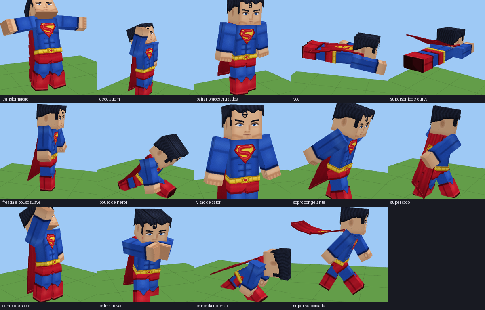
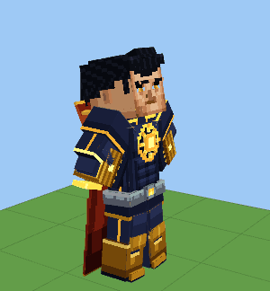
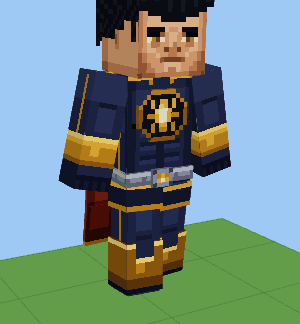
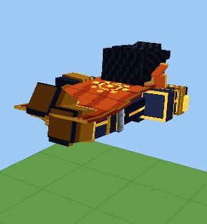
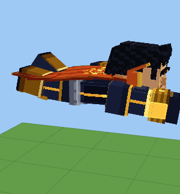
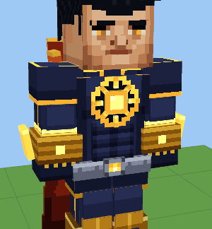
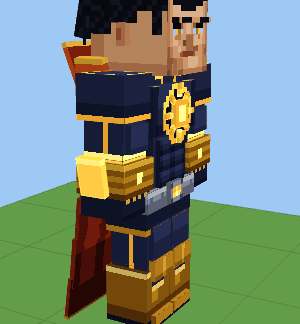
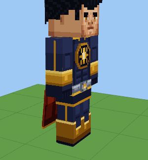
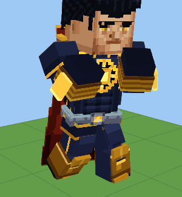
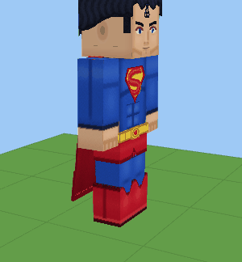

# Superman Add-on para Minecraft Bedrock

Add-on **não oficial** (feito por fã) que transforma o jogador no Superman. Ele voa com física suave, tem visão de calor, sopro congelante, super força, super velocidade e **destrói o cenário** com o voo e os poderes. O foco principal são as **animações**: são 71 animações, com transições suaves entre todos os estados.



---

## Instalação

1. Baixe **[`dist/Superman_Addon.mcaddon`](dist/Superman_Addon.mcaddon)**.
2. Abra o arquivo:
   - **Windows:** dê dois cliques. O Minecraft abre e importa os dois pacotes.
   - **Android/iOS:** toque no arquivo e escolha abrir com o Minecraft. No iOS, salve em *Arquivos* e toque nele.
3. Crie ou edite um mundo e ative, em **Pacotes de comportamento**, o *Superman Add-on (Comportamento)*. O pacote de recursos é ativado junto.
4. **Não precisa ativar nenhuma opção experimental.**

> Requer **Minecraft Bedrock 1.26.30 ou mais recente**. Os pacotes também estão separados em `dist/Superman_BP.mcpack` e `dist/Superman_RP.mcpack`.
>
> O add-on modifica a entidade do jogador. Outros add-ons que também alteram o jogador (`player.json` / `player.entity.json`) podem entrar em conflito.

---

## Como jogar

Ao entrar no mundo pela primeira vez você recebe o **Emblema do Superman**. Se perder, dá para fabricar:

```
 Redstone | Ouro     | Redstone
 Ouro     | Diamante | Ouro
          | Redstone |
```

**Use o Emblema** para se transformar. Ao se transformar você recebe os 5 itens de poder.

### Controles

| Ação | PC | Celular |
|---|---|---|
| **Começar a voar** | pular e pular de novo no ar | pulo duplo |
| **Decolagem carregada** (com cratera) | segurar **agachar** parado, depois **pular** | segurar agachar, tocar pular |
| Subir / descer no voo | segurar pular / agachar | segurar pular / agachar |
| Voar para frente | W (o corpo segue a câmera) | analógico para frente |
| **Voo supersônico** (atravessa montanhas) | correr (Ctrl ou W duplo) voando | botão de correr / analógico todo à frente |
| Frear e pairar | soltar W | soltar o analógico |
| Pousar | descer até o chão, ou usar **Poder: Voo** | idem |
| **Super velocidade** no chão | correr transformado | correr |
| Combo de socos | atacar (3 golpes seguidos = gancho) | atacar |
| Socar bloco (quebra na hora) | atacar o bloco de mão vazia | idem |
| **Configurações** | agachar + usar o Emblema | idem |

### Itens de poder

| Item | Uso |
|---|---|
| **Emblema** | transforma e destransforma (agachado abre as configurações) |
| **Poder: Voo** | no chão faz a decolagem automática; voando faz pousar |
| **Poder: Visão de Calor** | toque para ligar e toque de novo para desligar. Os raios saem dos olhos para onde você olha: pedra vira magma e depois lava, areia vira vidro, gelo derrete, madeira pega fogo e inimigos queimam. |
| **Poder: Sopro Congelante** | toque para usar. Ele inspira e depois sopra um cone de gelo: água vira gelo, lava vira obsidiana, apaga fogo, deixa neve no chão e deixa inimigos lentos. |
| **Poder: Super Soco** | toque para carregar (até 2 s) e toque de novo para soltar. Quanto mais carga, maior o soco: abre túneis na pedra, gera onda de choque e arremessa inimigos longe. |
| **Poder: Impacto** | no chão é a **palma trovão** (onda que arremessa inimigos e estilhaça vidro e folhas); agachado é a **pancada no chão** (cratera); voando é o **mergulho meteoro**, que termina num **pouso de herói** com cratera. |

Enquanto transformado: força, regeneração, resistência total, imunidade a fogo e queda, respiração aquática, super pulo e fome cheia.

### Destruição do cenário

- **Voo rápido e supersônico:** abre caminho através de qualquer bloco no trajeto, soltando detritos com a cor de cada bloco.
- **Estrondo sônico:** ao entrar no supersônico, estilhaça vidros, folhas e plantas em volta.
- **Pouso de herói:** a cratera cresce com a velocidade da queda.
- **Decolagem carregada:** cratera e rachaduras no chão.
- **Pancada, soco e palma:** crateras, túneis e ondas de choque.
- **Super velocidade:** derruba plantas, vidros e folhas no caminho.

Blocos como bedrock, portais e blocos de comando **nunca** são destruídos. Por padrão, baús e blocos com itens também são protegidos.

### Configurações (agachar + usar o Emblema)

- liga/desliga a destruição do cenário
- intensidade (leve / normal / devastador)
- blocos destruídos soltam itens ou não
- visão de calor incendeia e derrete ou não
- velocidade do supersônico (100 a 245 km/h)
- invulnerabilidade, tremor de câmera
- quantidade de partículas (use 1 em celular fraco)
- proteção de baús, soco que quebra bloco
- **inverter esquerda/direita** (se o desvio lateral no voo estiver trocado)
- mostrar velocidade na tela

---

## Animações

Todas as animações usam interpolação suave (catmull-rom), transições com mistura (*blend*) entre estados e camadas procedurais que se somam: capa, respiração, cacho do cabelo, inclinação nas curvas, flutuação e tremor de esforço.

| Voo e locomoção | Poderes | Camadas contínuas |
|---|---|---|
| decolagem: carga agachado, salto com punho para cima | transformação (cruza os braços e explode a energia) | **capa em 5 segmentos** com onda que percorre o tecido |
| decolagem no ar (pulo duplo) | destransformação | a capa levanta com a velocidade e sobe ao cair |
| pairar (flutuação, pernas balançando) | visão de calor (início, tensão com tremor, fim balançando a cabeça) | respiração |
| pairar com **braços cruzados** (parado por 2,5 s) | sopro congelante (inspira inclinando para trás e sopra) | cacho do cabelo balança com o movimento |
| inclinação ao se mover pairando | super soco: carga com torção do corpo | piscar de olhos |
| voo clássico (punho à frente, corpo segue a câmera) | super soco: golpe com avanço e retorno | olhos brilham na visão de calor |
| **inclinação nas curvas** (o corpo rola) | combo: jab, direto e gancho | cabeça segue a câmera em todas as poses |
| arrancada para o supersônico | palma trovão | pose de herói (mãos na cintura) parado ou no inventário |
| supersônico (dois punhos à frente, vibração) | pancada no chão | caminhada heroica e pose no ar ao pular |
| freada (as pernas balançam para frente) | animações em 1ª pessoa (carga, soco, vibração no supersônico) | |
| mergulho meteoro (de cabeça) | | |
| descida para pouso, pouso suave | | |
| **pouso de herói** (joelho e punho no chão, cabeça levanta, fica de pé) | | |
| subir e descer pairando, super velocidade correndo | | |

### Prévias

| | | |
|---|---|---|
|  transformação |  decolagem |  pairar / braços cruzados |
|  voo |  supersônico e curva |  freada e pouso suave |
|  pouso de herói |  visão de calor |  sopro congelante |
|  super soco |  combo de socos |  palma trovão |
|  pancada no chão |  super velocidade | |

*As prévias foram renderizadas fora do jogo pelo visualizador em `tools/preview`, com as mesmas animações e modelo do add-on. As partículas e a câmera aparecem só dentro do jogo.*

### Skin

Modelo próprio, com skin em alta resolução (1024×1024, 8 pixels por unidade e 16 no rosto e no emblema):

- rosto com olhos azuis, sobrancelhas, nariz, queixo marcado e o famoso cacho na testa
- cabelo com volume (camada 3D)
- emblema em relevo no peito
- cinto com fivela 3D, sunga e botas com recorte em V
- músculos pintados (peitoral, abdômen, deltoides, quadríceps)
- capa com dobras, bainha costurada e escudo amarelo nas costas

---

## Para desenvolvedores

Tudo é gerado por scripts, então é fácil ajustar poses, cores e física:

```
tools/gen_model.py        modelo 3D + pintura procedural da skin
tools/gen_client.py       animações, controladores, render controllers, player.entity.json
tools/gen_assets.py       partículas, ícones, itens, receita, textos, manifestos, player.json
tools/validate.mjs        valida JSON, ossos, Molang, referências, sons e partículas
tools/typecheck/          verificação de tipos dos scripts contra @minecraft/server 2.0.0
tools/simulate/           roda os scripts num mundo simulado (57 verificações)
tools/preview/            visualizador 3D (three.js) que renderiza as prévias em GIF
tools/build.sh            regenera tudo, valida, simula e empacota em dist/
superman_addon/           pacotes de comportamento (scripts) e de recursos
```

```bash
(cd tools/typecheck && npm install) && (cd tools/preview && npm install)
./tools/build.sh                                         # gera dist/*.mcaddon
python3 tools/preview/gifs.py /tmp                        # regera as prévias
```

### Como funciona

- O servidor (scripts) controla o voo aplicando a velocidade do jogador a cada tick, com aceleração suave e **autocalibração**. Ele mede a velocidade real e ajusta o ganho, para o voo responder igual em qualquer versão.
- O estado (voo, poder, carga, direção do controle) é sincronizado com o cliente por **propriedades de entidade** do jogador. Os controladores de animação usam essas propriedades para escolher as animações e misturar as transições.
- A inclinação nas curvas, a orientação do corpo seguindo a câmera e a física da capa são calculadas **no cliente**, a cada quadro, por Molang. Por isso ficam fluidas mesmo com atraso de rede.

### Limitações conhecidas

- O add-on foi verificado com validação estática, checagem de tipos da API e um simulador do mundo, mas **não foi testado dentro do jogo** neste ambiente. Alguns detalhes visuais, como o sentido da inclinação, a orientação de anéis de partícula e a intensidade da velocidade, podem precisar de ajuste fino. Se o desvio lateral estiver invertido, use a opção nas configurações.
- Muita destruição ao mesmo tempo pesa em celulares mais fracos. Nesse caso, reduza a intensidade e as partículas nas configurações.

---

*Projeto de fã, sem fins lucrativos, sem ligação com DC Comics, Warner Bros. ou Mojang. Superman é marca registrada da DC Comics.*
