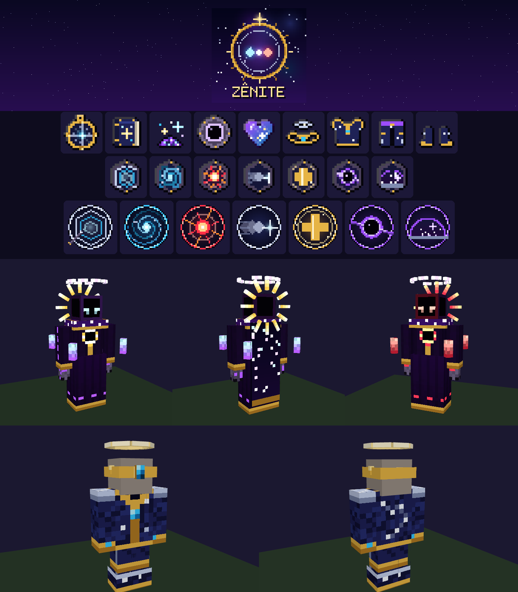

# Zênite — Feitiçaria do Firmamento



Add-on para **Minecraft Bedrock** com um feiticeiro original: o **Zênite**, que domina o espaço e as estrelas. São sete técnicas com efeitos e sons próprios, progressão de maestria, um traje completo e um chefe de três fases, o **Arconte do Eclipse**.

- Sem experimentos: funciona com as opções padrão do mundo.
- Celular (Android/iOS), Windows e consoles com Minecraft **1.21.120 ou mais novo**.
- Textos em **português** e **inglês**.
- Arte, modelos 3D e sons feitos do zero para este add-on.

---

## Instalação

1. Baixe o arquivo **`dist/Zenite.mcaddon`**.
2. Abra o arquivo:
   - **Celular:** toque no arquivo e escolha abrir com o Minecraft.
   - **Windows:** dê dois cliques.

   O jogo importa os dois pacotes sozinho.
3. Crie um mundo (ou edite um existente). Em **Pacotes de Comportamento**, ative **Zênite (Comportamento)**. O pacote de recursos é ativado junto, automaticamente.
4. Entre no mundo. Você recebe o **Códice do Zênite**, o guia dentro do jogo.

> Quer só testar? Ative as trapaças e use `/zenite:kit`. No **modo criativo**, todas as técnicas já vêm liberadas e o Éter não acaba.

## Como começar

| Item | Receita |
|------|---------|
| **Poeira Estelar** (×2) | fragmento de ametista + pó de glowstone + lápis-lazúli (sem forma) |
| **Astrolábio do Zênite** | `P D P` / `G O G` / `P D P`: P = poeira estelar, D = diamante, G = barra de ouro, O = olho do fim |
| **Códice do Zênite** | livro + poeira estelar |
| **Selo do Eclipse** | `C P C` / `P O P` / `C P C`: C = obsidiana chorona |
| **Traje do Zênite** | a peça de diamante no centro, cercada por 8 poeiras estelares |

**Controles do Astrolábio:**
- **Usar:** lança a técnica selecionada.
- **Agachar + usar:** abre a **Roda de Técnicas**. Nela você escolhe a técnica e encontra os Sigilos, o Status, as Configurações e o Códice.
- **Sigilos:** um item por técnica, para lançar direto da barra rápida.

Uma barra de **Éter** aparece na tela enquanto você segura o Astrolábio ou um Sigilo.

## As sete técnicas

| Técnica | Custo | Recarga | Libera | O que faz |
|---|---|---|---|---|
| **Véu Assintótico** | 10 + 3/s | 3 s | Nível 1 | Barreira que liga e desliga. Projéteis congelam no ar, nenhum golpe te alcança e monstros são empurrados. |
| **Poço Gravitacional** | 25 | 6 s | Nível 1 | Esfera ciano que suga criaturas, itens e blocos, esmagando o que chega ao centro. |
| **Supernova** | 30 | 7 s | Nível 1 | Projétil carmesim que explode numa onda de choque e arremessa tudo para longe. |
| **Passo Espacial** | 12 | 1,5 s | Nível 1 | Teletransporte de até 28 blocos. Mire numa criatura para surgir nas costas dela. |
| **Reversão Vital** | 40 | 20 s | Nível 2 | Cura 12 de vida, dá Regeneração II, apaga o fogo e remove efeitos negativos. |
| **Horizonte de Eventos** | 70 | 25 s | Nível 4 | Depois de 2 s de concentração, as esferas ciano e carmesim se fundem numa esfera violeta que apaga tudo pelo caminho. |
| **Abóbada Celeste** | Éter cheio | 120 s | Coração do Firmamento | A técnica suprema, descrita abaixo. |

**Abóbada Celeste:**
- Ergue uma cúpula estrelada de raio 14 por 20 s, com câmera cinematográfica.
- Os inimigos lá dentro ficam congelados.
- Você ganha Força II e Velocidade II, e lá dentro as técnicas não custam Éter.

## Éter e maestria

- O **Éter** começa em 100 e se regenera sozinho. Cada nível de maestria aumenta o máximo em 10 e acelera a regeneração.
- Ganha-se **maestria** derrotando criaturas e lançando técnicas. São 10 níveis.
- A **Abóbada Celeste** só é liberada com o **Coração do Firmamento**, deixado pelo Arconte do Eclipse.

## Traje do Zênite

- **Diadema:** visão noturna e uma auréola que gira sobre a cabeça.
- **Conjunto completo** (Diadema, Manto, Perneiras e Botas):
  - o Éter regenera 2× mais rápido;
  - você ganha Velocidade I;
  - o Véu gasta metade do Éter.

## O chefe: Arconte do Eclipse

Use o **Selo do Eclipse** num lugar aberto. O ritual dura 5 segundos, e então o Arconte desperta, com 500 de vida e barra de chefe.

1. **Fase 1:** ele puxa você e reaparece nas suas costas.
2. **Fase 2:** ergue um Véu Negro (4 s invulnerável), chama Ecos e dispara chuvas de novas.
3. **Fase 3 (fúria):** fica mais rápido e concentra o **Eclipse Total**. A trajetória fica marcada em vermelho, então saia da linha!

Ao ser derrotado, ele deixa:
- o **Coração do Firmamento**;
- diamantes, poeira estelar e uma estrela do Nether;
- 600 de maestria para quem participou da luta.

## Comandos

| Comando | Quem pode | O que faz |
|---|---|---|
| `/zenite:menu` | todos | Abre a Roda de Técnicas |
| `/zenite:codice` | todos | Abre o Códice |
| `/zenite:kit` | trapaças | Entrega o kit completo |
| `/zenite:nivel <1-10>` | trapaças | Define a maestria |
| `/zenite:arconte` | trapaças | Inicia o ritual do Arconte |
| `/zenite:limpar` | trapaças | Remove cúpulas da Abóbada que tenham ficado no mundo |

## Configurações (Roda de Técnicas → Configurações)

- **Suas preferências:**
  - câmera cinematográfica;
  - tremor de tela;
  - barra de Éter;
  - barra com ícones.
- **Do mundo (só operadores):**
  - técnicas destroem o terreno (ligado por padrão);
  - técnicas atingem outros jogadores (desligado por padrão);
  - dar o Códice a novos jogadores.

**Dica:** se a barra de Éter aparecer com quadradinhos, desligue **Barra com ícones**.

---

## Para desenvolvedores

```
zenite/
  BP/            pacote de comportamento (itens, bloco, Arconte, receitas e scripts)
  RP/            pacote de recursos (texturas, modelos, partículas, sons e textos)
  ferramentas/   geradores de texturas, modelos, sons e textos, validador e empacotador
  testes/        testes unitários e de fumaça (com um mock da API de scripts)
  dist/          Zenite.mcaddon, Zenite_BP.mcpack e Zenite_RP.mcpack
```

Para rodar os comandos abaixo, você precisa de:
- Node 22;
- Python 3 com Pillow, numpy e scipy;
- ffmpeg com libvorbis.

```bash
cd zenite
npm install                           # typings oficiais (@minecraft/server 2.3.0) e TypeScript
python3 ferramentas/gerar_texturas.py # ícones, bloco, armaduras, partículas, glifos e ícone do pacote
python3 ferramentas/gerar_modelos.py  # Arconte e Diadema (geometria + textura casadas)
python3 ferramentas/gerar_sons.py     # 19 efeitos sonoros em OGG
python3 ferramentas/textos.py         # pt_BR.lang e en_US.lang a partir de uma fonte única
npm run check                         # tipos + testes + validador
npm run build                         # gera dist/
```

- Os scripts usam `@minecraft/server` **2.3.0** e `@minecraft/server-ui` **2.0.0**.
- A checagem de tipos usa os typings oficiais.
- O validador confere referências entre arquivos: texturas, geometrias, partículas, sons, receitas e chaves de idioma nas duas línguas.

### Limitações conhecidas

- Os testes rodam num simulador da API de scripts, não dentro do Minecraft. Se algo se comportar diferente no jogo, o *Content Log* (Configurações → Criador) mostra os detalhes.
- Clicar com o Astrolábio num baú ou numa porta também lança a técnica selecionada.

## Créditos

Personagem, arte, modelos, sons e textos originais, criados para este projeto. Licença MIT.
